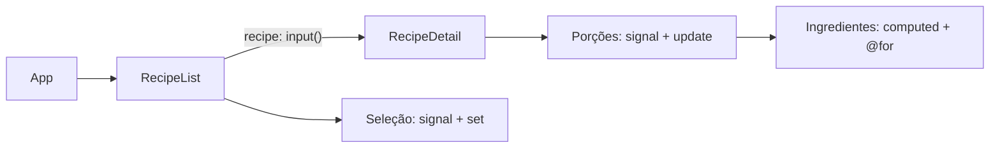

# Smart Recipe Box

Projeto individual da Atividade 09, criado com Angular CLI 22.2.5. Implementa somente as fases 1–3 do tutor oficial: fundamentos, Signals e arquitetura de componentes (módulos 1–12).

A aplicação permite selecionar duas receitas, ajustar o número de porções, recalcular ingredientes e identificar a receita favorita. As ilustrações SVG são locais. Não há backend nem persistência; ao recarregar, o estado volta ao inicial.

## Abrir e executar

Abra esta pasta `recipe-box` no VS Code. O projeto requer Node compatível com Angular 22; foi preparado com Node 24.21.0.

```powershell
npm.cmd ci
npm.cmd start
```

Na cópia já preparada, as dependências estão instaladas e basta `npm.cmd start`. Acesse http://localhost:4200. Deixe esse terminal aberto e use outro terminal para Git e comandos do CLI. Em outros sistemas, use `npm` no lugar de `npm.cmd`.

```powershell
npm.cmd run build
npm.cmd test -- --watch=false
```

## Conectar o tutor no VS Code

O gerador oficial criou `.vscode/mcp.json`, `AGENTS.md` e `.codex/config.toml`.

1. Abra **a pasta `recipe-box`** no VS Code.
2. Abra `.vscode/mcp.json` e clique em **Start/Iniciar** no servidor `angular-cli`. Aceite a autorização da ferramenta quando solicitada.
3. No chat do agente, envie:

   ```text
   Launch the Angular AI tutor
   ```

4. Envie o combinado, com seu nível informado:

   ```text
   Responda sempre em português. Meu nível de experiência é 5 de 10.
   Vamos construir a Smart Recipe Box seguindo a trilha oficial.
   Meu escopo é EXCLUSIVAMENTE: fase 1 (fundamentos), fase 2 (estado e reatividade com Signals) e fase 3 (arquitetura de componentes).
   Quando terminar a fase 3, PARE. Não avance para serviços, injeção de dependência, rotas ou formulários.
   Mantenha Objetivo e O que fazer em cada exercício. Escolhi o caminho 3: você gera e explica; eu leio e reviso. Se eu quiser tentar sozinho, aviso.
   O código foi gerado com assistência e há um commit por módulo. Leia os arquivos e me ajude a revisar o que foi implementado. Where are we?
   ```

A ferramenta `ai_tutor` fornece o currículo e as orientações que o agente usa para ensinar e revisar. A confirmação deve vir da leitura real do projeto; a chamada da ferramenta sozinha não certifica conclusão ou aprendizado. Se o chat não encontrar o tutor, peça: `Use a ferramenta ai_tutor do servidor angular-cli` e confira se o servidor está ativo. No Codex, a configuração de MCP é `.codex/config.toml`, válida quando esta pasta é aberta como projeto confiável.

Documentação: [MCP do Angular](https://angular.dev/ai/mcp), [tutor oficial](https://angular.dev/ai/ai-tutor) e [MCP no Codex](https://developers.openai.com/codex/mcp).

## Como o código está organizado



- `src/app/models.ts`: contratos `RecipeModel` e `Ingredient`.
- `src/app/mock-recipes.ts`: dados de exemplo com quantidades para **uma porção**.
- `src/app/recipe-list/`: seleção da receita e favorita com `@if`.
- `src/app/recipe-detail/`: dados recebidos por `input()`, porções e ingredientes derivados por `computed()`.
- `public/images/`: ilustrações locais.

As imagens usam `[ngSrc]` com `NgOptimizedImage`, uma aplicação do property binding do módulo 7. No Angular 22, standalone e OnPush já são os padrões.

## Validação técnica

Build de produção aprovado, seis testes de comportamento aprovados e conferência no Chrome em desktop e celular. Veja as [capturas da aplicação](docs/PROGRESSO.md). A implementação conclui a fase 3; os itens de participação pessoal abaixo continuam pendentes.

## Revisão e entrega

A geração com explicação foi autorizada pelo aluno, que informou experiência 5/10 e escolheu o caminho 3. Os commits registram mudanças reais feitas pelo agente; a revisão pessoal ainda precisa ser realizada.

1. Leia [os 12 exercícios e perguntas de revisão](docs/EXERCICIOS.md) e consulte cada commit pelo Source Control do VS Code ou `git log --oneline` / `git show HASH`.
2. Confira o [registro técnico e as pendências](docs/PROGRESSO.md).
3. Faça o [material no NotebookLM](docs/NOTEBOOKLM.md), ouvindo o podcast e respondendo o quiz, ou gerando o mapa mental permitido.
4. Preencha o [modelo de entrega no Moodle](docs/ENTREGA-MOODLE.md) com suas evidências e os dois parágrafos escritos por você.

A atividade só está pronta para entrega depois da revisão do código, da confirmação do tutor, do material do NotebookLM e dos relatos pessoais.
